<picture>
  <source media="(prefers-color-scheme: dark)" srcset="docs/images/nullbot-hero-dark.svg">
  
</picture>

The NullBot desktop app. Chat with an agent and watch every step it takes,
answer it through interactive visuals, browse and preview your project files,
and manage models, accounts, tool servers, skills, permissions and history,
all in one window.

It is a [Wails](https://wails.io) app (Go and React) on top of the
[NullBot](https://github.com/Bradthebrad/nullbot) runtime and
[tinychain](https://github.com/Bradthebrad/tinychain). The terminal UI and the
headless CLI in the NullBot repository use the same NullBot folder, so
conversations, projects, schedules and settings carry across.

**[Download for Windows](https://github.com/Bradthebrad/nullbot_ui/releases/latest)** (x64; uses the Microsoft Edge WebView2 Runtime)

<picture>
  <source media="(prefers-color-scheme: dark)" srcset="docs/images/chat-dark.png">
  
</picture>

## How NullBot works

NullBot starts from a small set of built-in tools and adds heavier ones only
as separate tool servers you choose to install: coding, web search and
browser automation, document parsing, images, email, drives and messages. You
talk to it in text, or through visuals it shows you when pointing is easier
than typing. A manager agent plans and hands work to subagents, each on any
provider and model you have set up, and every tool call is checked against
the permission of the project it touches.

<picture>
  <source media="(prefers-color-scheme: dark)" srcset="docs/images/how-it-works-dark.svg">
  
</picture>

## Chat with a live trace

- **Every step in view.** The Activity panel lists what the manager and each
  subagent are doing as they do it: what was read, searched, fetched, shown or
  blocked, how long it took, and how much room it took in the context window.
  Click a step for its arguments and result.
- **Blocked steps explain themselves.** When a project's permission stops a
  call, the step says which project, what the call needed, and where to change
  it.
- **Steer the run.** Type while a request runs to steer it, ask a question on
  the side without interrupting it, or queue the next request. Pause, have it
  stop after the current step, or stop everything now.
- **Context you can see.** The meter by the composer shows how full the
  model's context window is, and when NullBot will shorten old tool results or
  summarize earlier messages.
- **Attachments.** Drop files on the window or paste them; pictures are shown
  inline.
- **Commands.** `Ctrl+K` opens a palette for every view, setting and run
  control; `Ctrl+1` to `Ctrl+6` switch views.

<table>
  <tr>
    <td width="50%">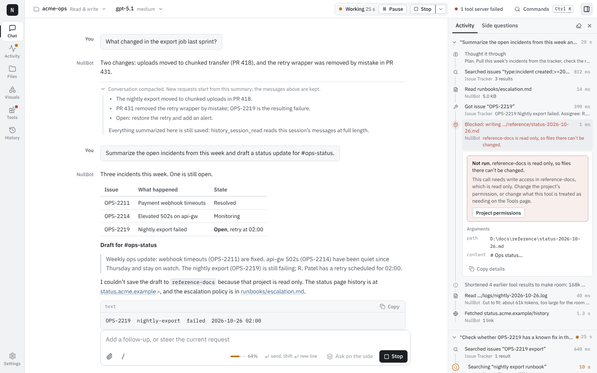</td>
    <td width="50%">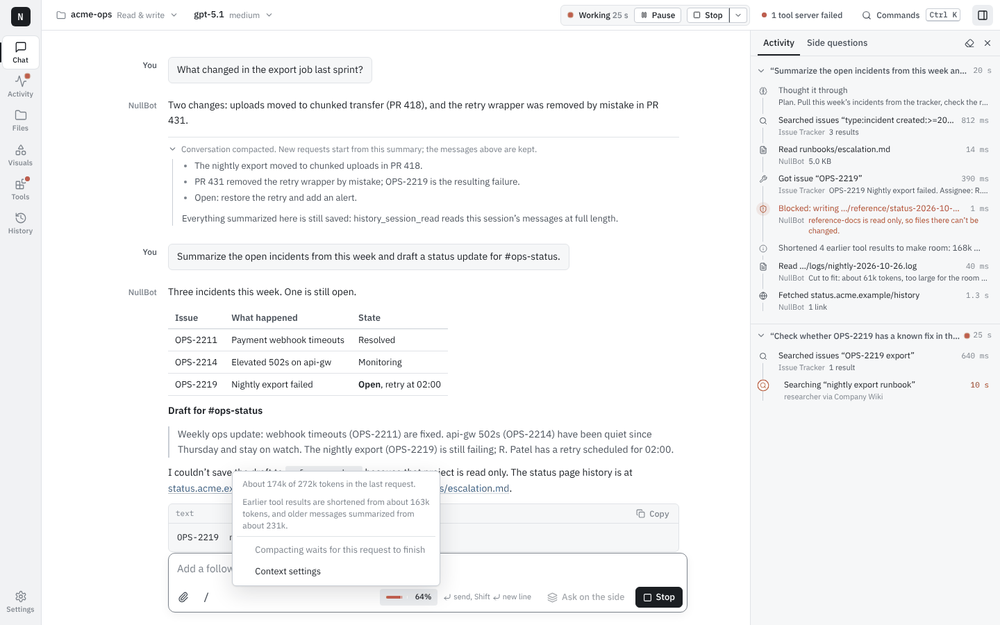</td>
  </tr>
  <tr>
    <td>A write the project doesn't allow, explained in the trace</td>
    <td>The context meter and what happens next</td>
  </tr>
</table>

## Interactive visuals

When a choice, a label or a test is easier to point at than to describe, the
agent opens a visual with the `visualize` tool. It pops up beside the
conversation, records what you do, and sends your answer, your note and the
interactions when you press **Send to NullBot**. Use it for:

- **Polls** to settle a preference: which headline, which layout, which plan.
- **Prototypes you test.** The agent builds a page and asks you to try it; it
  sees every click, form change and script error, so it knows whether the
  buttons work.
- **Labeling.** Pin labeled points on a picture; the agent gets each point in
  the picture's pixels.
- **Charts and diagrams.** Click the bar that looks wrong or the parts of an
  architecture that touch a database.
- **Small games and anything else in HTML**, with scripts running in a
  sandboxed frame.

<table>
  <tr>
    <td width="50%">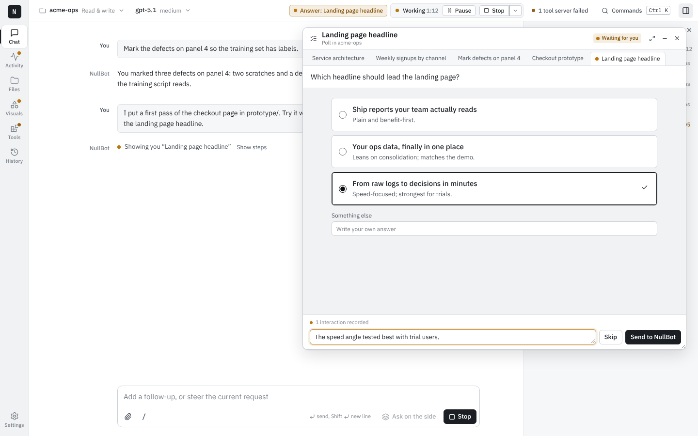</td>
    <td width="50%"></td>
  </tr>
  <tr><td>Poll</td><td>Prototype test</td></tr>
  <tr>
    <td>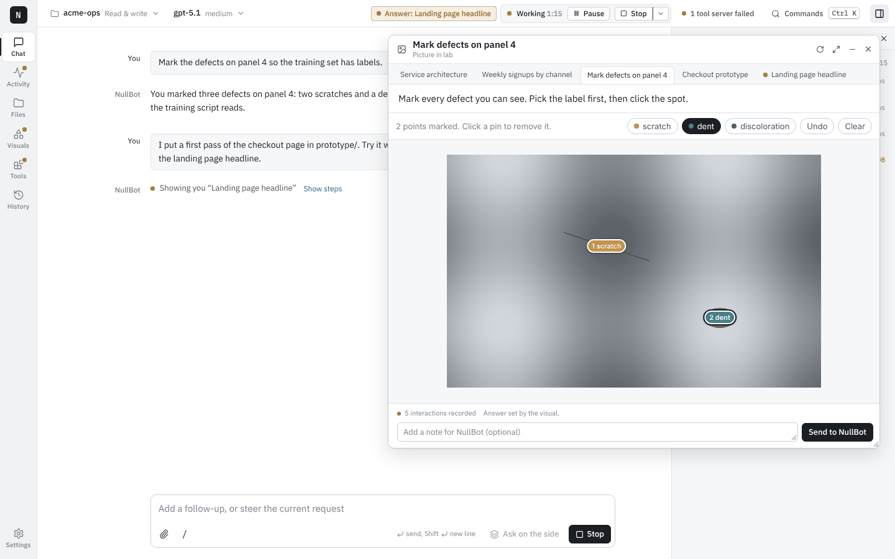</td>
    <td>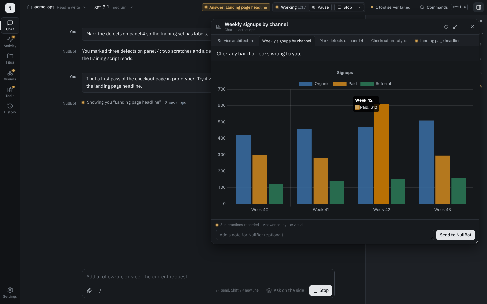</td>
  </tr>
  <tr><td>Labeling a picture</td><td>Clickable chart</td></tr>
</table>

Visuals are saved with the project, under `.nullbot/visualizations`. The
**Visuals** page lists them by project, shows what was sent back, and replays
every interaction with its time, including script errors from a prototype.

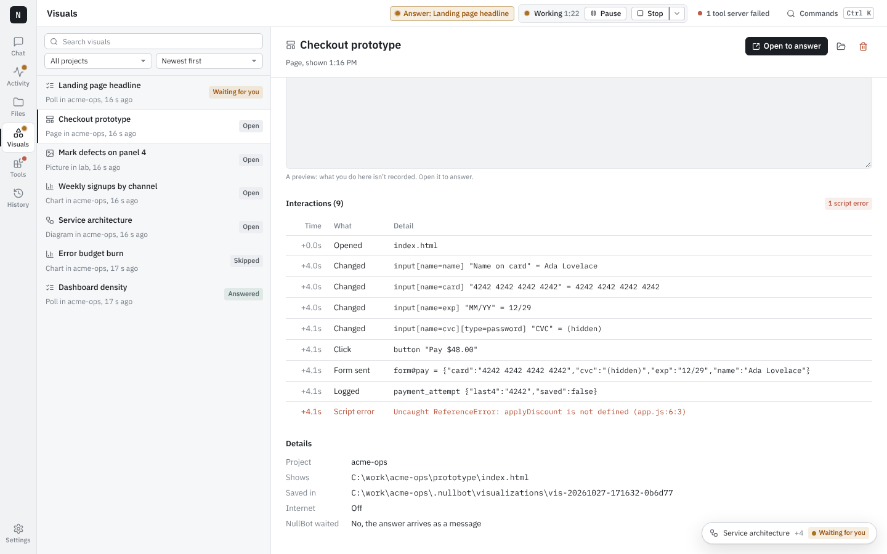

A visual's page can't reach NullBot or the app, and it has no internet unless
the agent asks for it and the project has the Full permission. Details are in
[NullBot's docs/VISUALS.md](https://github.com/Bradthebrad/nullbot/blob/main/docs/VISUALS.md).

## Agents, runs, plans and schedules

Pick the manager's model and, separately, the subagents' model, from any
provider you have set up: a ChatGPT subscription (sign in), OpenAI, Anthropic
or OpenRouter. Context windows are filled in from the provider or a built-in
table and can be overridden. **Activity** lists every run, subagent and
scheduled task, with its tools, tokens and result; plans show their steps and
can be continued; schedules run once, at a time, or on repeat.

<table>
  <tr>
    <td width="50%">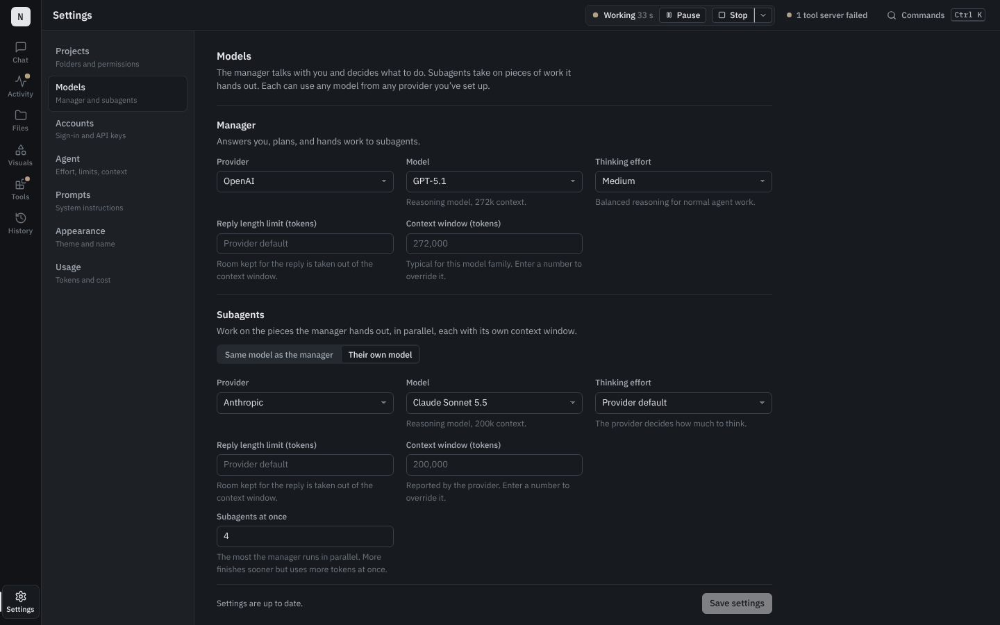</td>
    <td width="50%">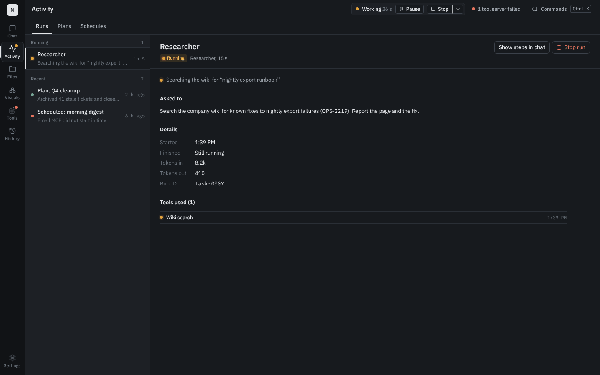</td>
  </tr>
  <tr><td>A manager and subagents on different providers</td><td>Runs, with what each subagent was asked and used</td></tr>
</table>

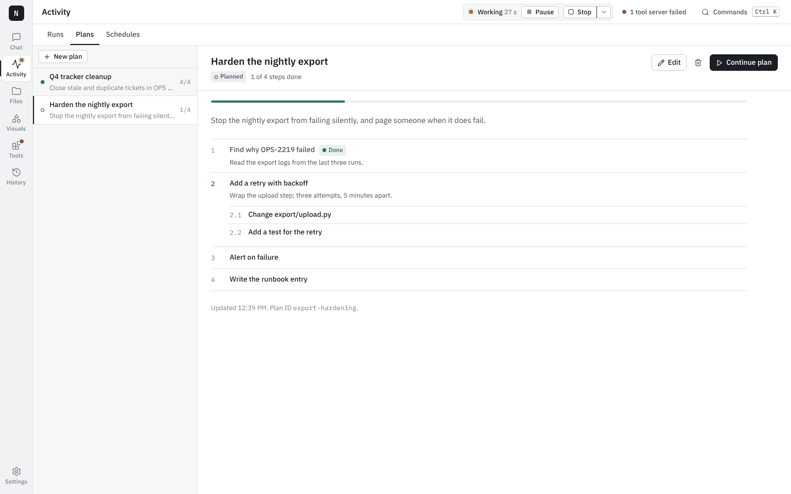

## Files

Each project is a tab, with its permission shown. Browse, filter, search
subfolders, and preview Markdown, code, JSON, CSV and spreadsheets, Word and
PowerPoint files, PDFs, pictures, audio, video and the contents of archives.
Edit text files in place, and create, rename or delete within the project's
permission.

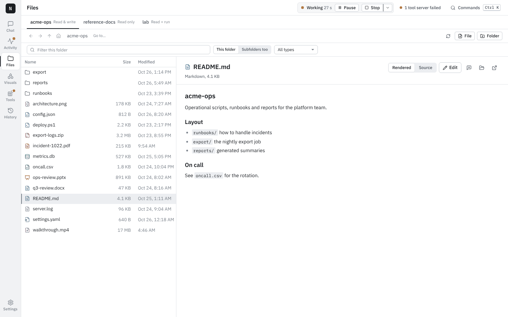

## Tools, skills and the Marketplace

Every tool server shows its state, calls, failures and typical time, and every
tool shows what it needs (read, write, delete or run) and why, with a menu to
change it or block the tool. The Marketplace installs NullBot's tool servers
from their GitHub releases, verified against each release's checksums, and
skill packs from the skills repository; any other MCP server can be added by
hand, local or remote.

<table>
  <tr>
    <td width="50%">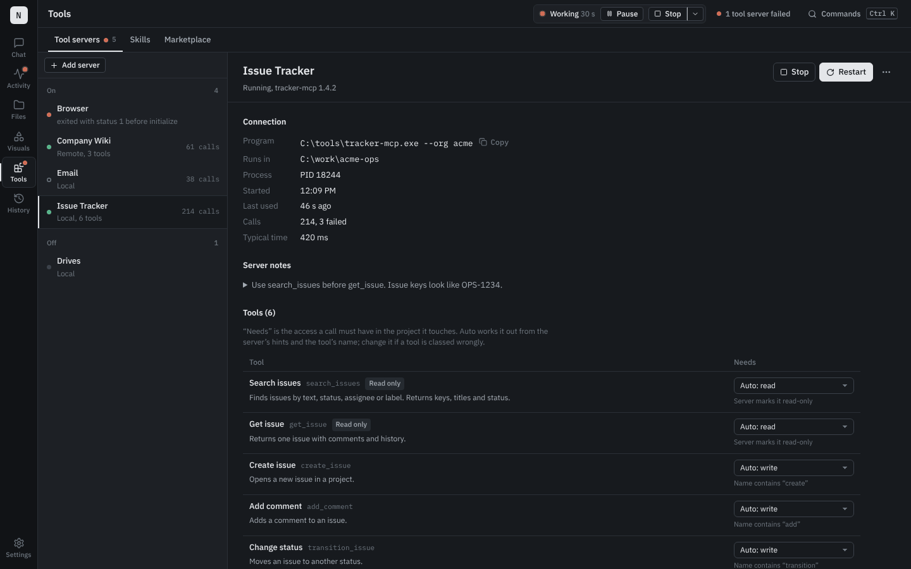</td>
    <td width="50%">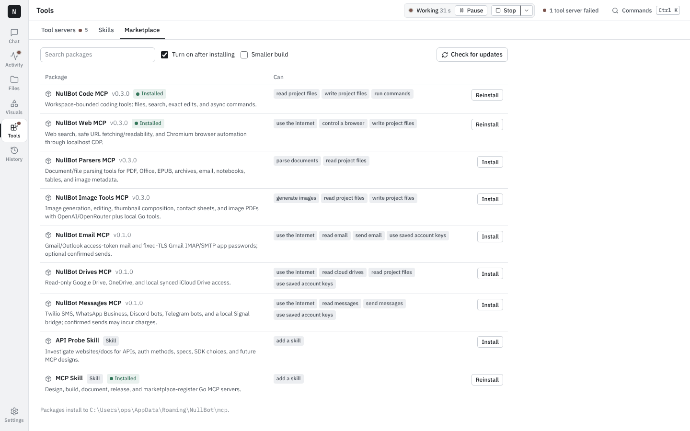</td>
  </tr>
</table>

| Tool server | What it adds |
| --- | --- |
| [Code](https://github.com/Bradthebrad/nullbot-code-mcp) | Read, search and exactly edit files, and run commands, inside the project |
| [Web](https://github.com/Bradthebrad/nullbot-web-mcp) | Web search, readable page fetches, browser automation and testing |
| [Parsers](https://github.com/Bradthebrad/nullbot-parsers-mcp) | Text, tables and metadata from PDF, Office, EPUB, archives and notebooks |
| [Image Tools](https://github.com/Bradthebrad/nullbot-imagetools-mcp) | Image generation and editing, thumbnails, contact sheets, PDFs |
| [Email](https://github.com/Bradthebrad/nullbot-emails-mcp) | Gmail and Outlook |
| [Drives](https://github.com/Bradthebrad/nullbot-drives-mcp) | Google Drive, OneDrive, synced folders, read only |
| [Messages](https://github.com/Bradthebrad/nullbot-messages-mcp) | Discord, Telegram, Twilio SMS, WhatsApp Business, Signal bridge |

Skill packs for web search, browser automation and research, API probing and
building MCP servers come from
[nullbot-skills](https://github.com/Bradthebrad/nullbot-skills).

## Projects, permissions and context

**Settings > Projects** sets the folders NullBot may work in and what it may
do in each: Read only, Read & write, Full (adds running programs) or Custom.
The rules apply to every tool, built in or from a tool server on this machine
or another; where projects overlap, the stricter one wins. **Settings > Agent**
sets how far a request may go on its own and how NullBot keeps a long
conversation inside the context window: when to shorten tool results, when to
summarize, and how much of the conversation a new request carries.

<table>
  <tr>
    <td width="50%">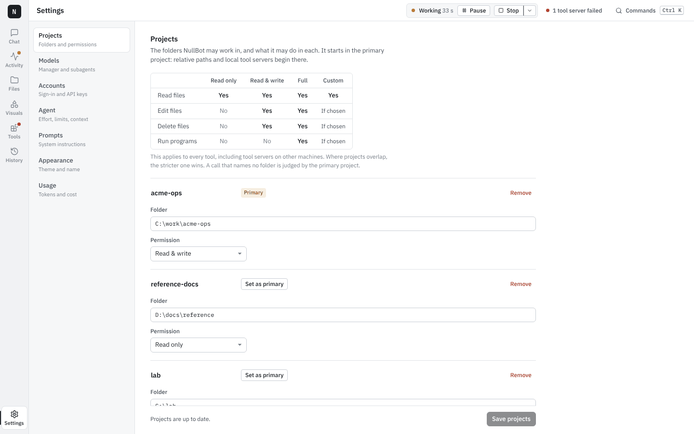</td>
    <td width="50%">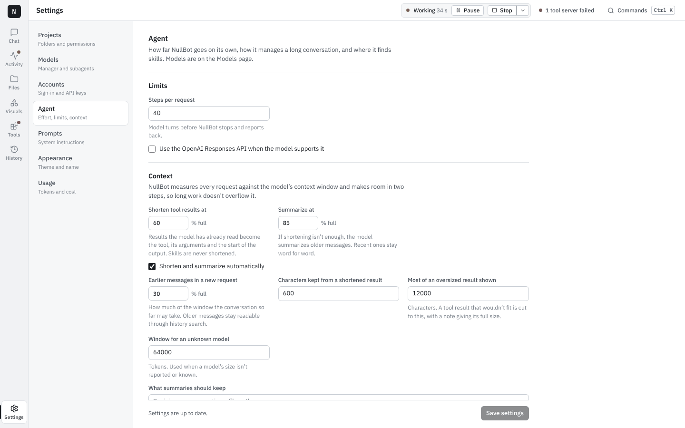</td>
  </tr>
</table>

## History

Every message and tool call is saved. **History** searches all of it, with
filters for messages or tool calls, shows where each match is, and continues
any past conversation.

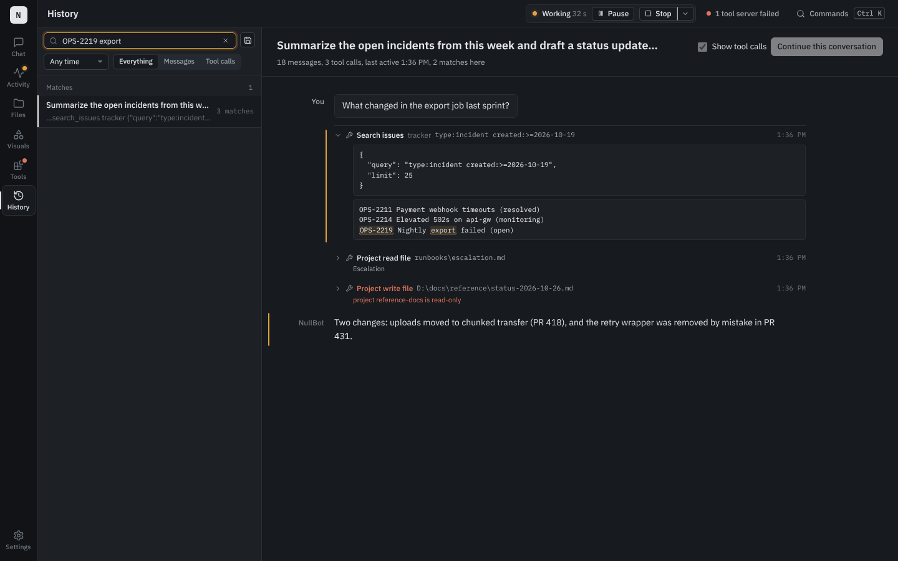

## Accounts

**Settings > Accounts** holds API keys, the ChatGPT subscription sign-in, and
service accounts for the email, drives and messages servers: Gmail (API or
IMAP/SMTP with an app password), Outlook, Google Drive, OneDrive, iCloud Drive
folders, Twilio, WhatsApp Business, Discord and Telegram bots, and a local
Signal bridge.

- Secrets are stored with Windows current-user DPAPI and never shown again.
  Replacing an account replaces all of its fields.
- An account is passed only to the matching server installed from the
  Marketplace, checked against its pinned hash, and never to a server you
  added by hand.
- Sending is off for a new account. With it on, each send still needs your
  confirmation in the conversation.
- Saving, deleting or refreshing an account contacts no provider and installs
  nothing.

The account fields for each service, and their limits, are in
[NullBot's docs/SERVICE_ACCOUNTS.md](https://github.com/Bradthebrad/nullbot/blob/main/docs/SERVICE_ACCOUNTS.md).

## Other ways to run NullBot

The same agent runs in the terminal (`nullbot`) and headless (`nullbot -p
"…"` for one request, `nullbot serve` for scheduled tasks and a request
stream). Both are in the [NullBot repository](https://github.com/Bradthebrad/nullbot),
with [headless docs](https://github.com/Bradthebrad/nullbot/blob/main/docs/HEADLESS.md).
Visuals need this app, since someone has to answer them.

## Install

1. Download `nullbot_ui.exe` (or the ZIP) and `SHA256SUMS.txt` from the
   [latest release](https://github.com/Bradthebrad/nullbot_ui/releases/latest).
2. Check the hash: `Get-FileHash .\nullbot_ui.exe -Algorithm SHA256`, and
   compare it with `SHA256SUMS.txt`.
3. Run it. The executable isn't signed, so SmartScreen may ask first.

Your settings, keys and history stay in your NullBot folder (`~/.nullbot`)
and are not part of any download.

## Build from source

You need Go 1.26.4 or later, Node.js with npm, and the Wails CLI.

```sh
go mod download
cd frontend && npm ci && npm test && npm run build && cd ..
go test ./...
wails dev      # run with live reload
wails build    # build the app
```

The Go side imports tagged releases of `github.com/Bradthebrad/nullbot` and
`github.com/Bradthebrad/tinychain`, so no sibling checkouts are needed.
Releasing is described in [docs/RELEASING.md](docs/RELEASING.md), and each
version's notes are in [docs/changelog](docs/changelog).

## Roadmap

Planned, not built yet: local models on `localhost`, the LAN or an internal
domain; model installs with [llmfit](https://github.com/AlexsJones/llmfit) and
Hugging Face; and tool servers that create and tear down AWS and Google Cloud
infrastructure, with every change confirmed first. See
[NullBot's roadmap](https://github.com/Bradthebrad/nullbot/blob/main/docs/ROADMAP.md).

## Privacy

No API keys, account tokens, sign-in files, configuration, session data or
project content belong in this repository. The app reads them from your
NullBot folder and environment at run time.
